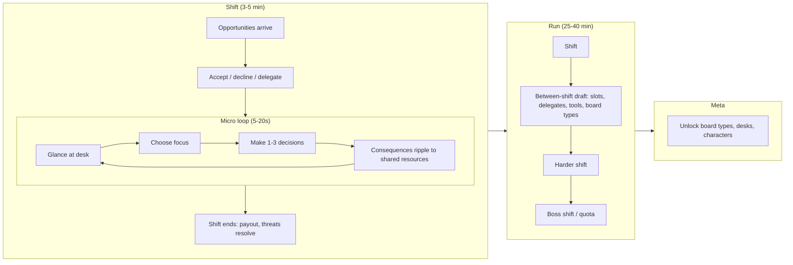

# Strategic Attention Management Game: Concept Review

Status: pre-prototype critique. Nothing here has been playtested. Treat every recommendation as a hypothesis to prove or disprove.

---

## 0. Relationship to the existing Clutch Tavern work

This repo already contains **Clutch Tavern** (`GDD.md`, `Technical-Architecture.md`, `Vertical-Slice-Roadmap.md`, `ClutchTavern/`). That concept is an 8-player auto-battler with periodic, synchronized skill challenges. The new brief explicitly rejects all three of its defining traits: *not an auto-battler*, *not minigames that interrupt*, and *not reflexes*. **This is a pivot, not an iteration.** Make that call deliberately rather than letting the two concepts blur.

Clutch Tavern's own GDD already pointed toward this pivot. It flagged the "audience mismatch" between strategy and twitch players as its top risk, called Reflex Gate the "weakest idea," and preferred cognitive challenges. The attention concept takes those findings to their conclusion: drop the separation between the "real game" and the "challenge," and make **choosing between concurrent strategic demands** the game itself.

| Clutch Tavern asset | Status under the pivot |
|---|---|
| `GameCore` package boundary, value-type `RunState`, pure `RunEngine.apply`, `RunSession` (decisions D1 to D7) | **Keep.** This is exactly the right foundation. Extend it (see §7). Don't replace it. |
| Seeded determinism, Swift 6, Swift Testing, XcodeGen (D10) | **Keep.** |
| iPhone-only, portrait (D10) | **Revisit.** Several concurrent boards need screen space. Recommend iPad and Mac first, with iPhone as a separate later layout. |
| Multiplayer, GameKit, matchmaking, anti-cheat (GDD §7, architecture §8) | **Drop.** Single-player first. This removes the GDD's highest-cost and highest-risk work. |
| Skill-challenge catalog (Target Rush, Reflex Gate, Perfect Timing) | **Drop.** These violate "decisions over reflexes." |
| Memory Match / Pattern Spotter | **Drop as standalone challenges.** Memory survives only as an *emergent* cost: remembering the state of unfocused boards. |
| Units, tribes, shop economy | **Shelve.** Some ideas could become one board type (a "Garrison" board), but they're no longer the primary layer. |
| Milestone 1 design lock, Memory Match slice, challenge-vs-fixed-reward A/B test | **Superseded** by the time-model A/B test in §5. |
| Lessons on reward containment (choices over stats, catch-up, diminishing returns) | **Keep.** They apply directly to convex returns and delegation balance. |

**Recommendation:** freeze the Clutch Tavern docs as an archived concept rather than editing them, and run Prototype 0 (paper) for this concept before writing more Swift. If the paper test fails, Clutch Tavern's slice is still a valid fallback.

---

## TL;DR

1. **The central claim has a hole.** In a turn-based or pausable game, attention isn't scarce, because the player can look at everything. Attention only becomes a resource if something makes it scarce: real time, hidden information, or an action budget. Each of those choices produces a very different game. **This is the first question the prototype must answer.** Theme, card battler, and side-activity list all come after it.
2. **A card battler is a poor primary layer.** A card battle is a self-contained puzzle that rewards deep, uninterrupted focus. That's the opposite of what this game asks for. Players will resent anything that pulls them away from it. Keep the cards, but move them up a level: **opportunities are the cards.**
3. **Get rid of the idea of a "primary layer plus side activities."** Use a *simul* structure instead, like a chess grandmaster playing 20 boards at once. Every panel is a first-class "board." The real primary layer is the **desk**: the portfolio of commitments the player chose to take on.
4. **Most of the listed side activities are wrong for this game.** Chess-like and Go-like puzzles need deep focus. Pattern recognition turns into a reflex test. Card battles need deep focus. Keep only activities that are **glanceable, short to act on, persistent, and harmed by neglect**.
5. **The fastest test is a one-week paper prototype with three boards and a chess clock.** Follow it with a SwiftUI greybox that A/B tests three time models on the same content. Set kill criteria before you build.
6. **The biggest commercial risk is that it "feels like my job."** Context switching is a real cognitive tax, and it's unpleasant by default. Theme, pacing, and the ability to **buy back attention** through delegation and automation are what turn the tax into a power fantasy.

---

## 1. Concept Critique

### What's strong

- **The fantasy is real and recognizable.** Being the person who keeps many plates spinning (air-traffic controller, head chef, trader, general, simul grandmaster) is aspirational. Mastery is visible, because experts look calm while novices drown.
- **The opportunity-cost framing is the right one.** Good strategy games are about choosing *not* to do things. This concept makes that explicit and puts it at the center.
- **It has natural escalation.** Adding concurrent demands is an intuitive difficulty curve that needs little explanation.
- **"Decisions over reflexes" is the right instinct.** It separates this game from Diner Dash, Overcooked, and Cook, Serve, Delicious!.

### What's weak or unresolved

| Issue | Why it matters |
|---|---|
| **Attention is never made scarce** | If the player can pause or the game waits for input, they can attend to everything. All that remains is an action economy, which every strategy game already has. The pitch depends on something the design doesn't yet enforce. |
| **"Decisions over reflexes" conflicts with "limited decision time"** | Time pressure is the easiest way to create attention scarcity, and also the fastest route back to a reflex test. This tension needs a deliberate mechanism, not a slogan. |
| **"Not interruptions" conflicts with "popups, alerts, events"** | Popups *are* interruptions by definition. If the game pushes content at the player, it will feel like notifications. The player must **pull**. |
| **Multiple paths to victory can kill the core** | If puzzle mastery alone can win, a player can ignore everything else, and then there's no attention tension. Specialization should be *possible*, but spreading out must be *necessary*. |
| **The activity list is a content trap** | Each activity is effectively its own small game, with its own rules, UI, AI, tutorial, and balancing. Thirteen activities means thirteen games, so quality will be uneven. "Minigame collection" is a stigma in reviews. |
| **There's no interconnection model** | If the activities don't feed each other, this is parallel solitaire. The strategy has to come from **shared resources and cross-activity consequences**. |
| **Failure attribution** | When the player loses, can they tell *which* allocation decision caused it? If not, they won't learn and they'll feel cheated. |

### The core question, restated

> Is choosing what to attend to fun on its own, separate from the quality of each individual activity?

If the answer is "only if each activity is great by itself," the project is really 6 to 8 games and very expensive. If the answer is "yes, even with simple activities," you have a scalable design. **The prototype must isolate this.**

---

## 2. Comparable Games Analysis

### Closest by mechanism

| Game | What it shares | What to learn |
|---|---|---|
| **Cultist Simulator / Book of Hours** | Many concurrent timers, juggling verbs and cards, pause available | Pausable time still creates tension when *everything decays*. Its UI opacity is a warning. |
| **Do Not Feed the Monkeys** | Literally watching several camera feeds at once and choosing which to observe | Proves the "glance vs. focus" fantasy has an audience. It also shows how it turns tedious when the feeds are passive. |
| **Papers, Please** | Rule juggling under a soft clock, multiple simultaneous checks | A soft time limit plus moral and economic stakes, with no reflex demand. **This is the best reference for the time model.** |
| **Mini Metro / Mini Motorways** | Escalating concurrent demands, small decision vocabulary, failure caused by neglected lines | A calm aesthetic plus mounting overload equals "meaningful overload." The decisions are tiny but consequential. |
| **FTL: Faster Than Light** | Many ship systems compete for attention in real-time-with-pause | Pause makes attention scarce *per moment*, not overall. That's an acceptable compromise. |
| **Stacklands** | Juggling many small card-based systems on one board | Cards as the units of opportunity work well. Late-game clutter is the failure mode. |
| **Cook, Serve, Delicious! 2/3** | Pure time-management queue juggling | **This is the anti-model:** fun, but it skews toward APM and memorization. |
| **StarCraft (macro vs. micro)** | Attention as the real resource at high skill levels | Shows how attention economies become APM economies when unconstrained. |
| **Space Alert / Captain Sonar (board games)** | Real-time cooperative attention overload | Real time works as a *social* experience, but it's stressful solo. |
| **Simultaneous exhibition chess (simul)** | One expert, many boards, each opponent waits for you | **Strongest framing:** each board has its own clock, so attention is time. |

### Closest by market position

- **Balatro, Luck be a Landlord, Slay the Spire:** run-based, systemic, highly replayable. This is where the commercial demand is on Apple platforms and Steam.
- **Into the Breach:** perfect information, decisions over reflexes. The benchmark for "tactical but calm."
- **Universal Paperclips, A Dark Room:** systems unlock over time and the screen keeps growing. That's a natural fit for gradually adding activities.
- **Opus Magnum, TIS-100 (Zachtronics):** deep puzzles. **Warning:** these need total focus and don't belong as side activities.

### What's genuinely novel (honest assessment)

- **Not novel:** time management, multi-system juggling, escalating load, roguelite runs. All have strong precedents.
- **Potentially novel:**
  1. **Attention as an explicit, upgradeable, spendable resource.** You buy it back through delegation and automation, and the run's build *is* your attention strategy.
  2. **Glance vs. focus information model.** Unattended panels show degraded, summary-level information. The cost of neglect is **uncertainty**, not just decay.
  3. **Opportunities as a drafted card economy at the meta level.** You choose which commitments to take on, not just which to service.
  4. **A cerebral simul:** strategic depth across concurrent boards, with no reflexes required.

The novelty sits in the **combination plus the meta-layer**. No single mechanic is new. That's fine, because Balatro's mechanics weren't new either, but the pitch has to make the combination legible in about 10 seconds.

---

## 3. Revised Gameplay Loop

### Reframe: the Desk

There's no privileged primary game. The player has a **Desk** with a limited number of **Slots** (start with 2, maximum around 5). Each slot holds a **Board**: a small, persistent, ongoing strategic situation such as a trade route, a market position, a defense line, or a contract.

- **Opportunities** arrive as **cards** in an inbox rail. They never take focus away from the player.
- Each card shows: board type, potential reward, deadline, **load** (how much attention it will demand), and **neglect behavior** (what happens if you ignore it).
- The player **accepts** an opportunity into a free slot, **declines** it, or **delegates** it to an automaton (lower yield, no attention needed).
- Only **one board is in Focus** at a time. Focused boards show full information and accept actions. Unfocused boards show a **glance summary**: a status icon, trend, and countdown, with no detail.

That gives three nested choices, each a form of opportunity cost:

1. **Commitment** (what do I take on?): drafting
2. **Allocation** (what do I look at now?): attention
3. **Action** (what do I do here?): tactics

### Loop timescales



### Systems that make it strategic, not just busy

- **Shared economy.** All boards draw on and feed one or two shared resources, for example **Coin** and **Heat** (risk). The market funds logistics, logistics supplies defense, and defense lowers Heat. That interdependence is where the strategy comes from.
- **Convex returns.** The first unit of attention on a board is worth the most. Staying focused on one board brings diminishing returns, and neglect penalties **escalate**. Spreading attention is necessary, while specializing is possible but costly.
- **Delegation.** Buying an automaton for a board lets it run at about 60% efficiency with zero attention. **This is the build axis:** a run is really about deciding which boards you personally handle and which you hand off. It also turns rising load into a power fantasy instead of a drowning feeling.
- **Focus tools** (scarce consumables): *Freeze* (stop one board's clock), *Insight* (reveal a glance board's full detail), *Triage* (skip one neglect penalty). These give the player relief valves.
- **Quota or boss shifts.** Fixed checkpoints, Balatro-style, create clear goals and make failure easy to read.

### Rules every Board type must follow

A board type ships only if it passes all six:

1. **Glanceable.** Its state can be read from a summary in under 3 seconds.
2. **Short actions.** A meaningful decision takes 1 to 3 inputs.
3. **Thinking pays.** Spending longer on a decision gives a better result, so time spent is a real cost. A one-second correct answer is a reflex test, not a decision.
4. **Persistent.** State carries forward across focus switches. It isn't a self-contained minigame.
5. **Defined neglect behavior.** It specifies what happens when ignored: decay, a missed window, or an escalating threat. The behavior must be **telegraphed** on the glance view.
6. **Coupled.** It consumes and/or produces a shared resource.

---

## 4. Risks and Mitigations

### Design risks

| # | Risk | Severity | Mitigation |
|---|---|---|---|
| D1 | **Attention isn't actually scarce**, so the game reduces to an ordinary action economy | Critical | Time-model A/B test (see §5). The glance/focus information model makes neglect cost information, not just time. |
| D2 | **It turns into an APM or reflex test** | Critical | Keep the pacing slow (clock beats in seconds, not milliseconds). Make thinking-pays a hard rule. No dexterity inputs. Ship a time-scale accessibility slider. |
| D3 | **Fun depends on each activity being individually great**, which makes content expensive | High | Limit the vertical slice to three boards. Test whether allocation is fun with deliberately simple boards. |
| D4 | **A dominant strategy appears**, such as "always ignore the market" or "delegate everything" | High | Convex returns, shared-resource coupling, and Monte Carlo bot balancing (see §7). |
| D5 | **Rote rotation**: the optimal play becomes "cycle panels A→B→C" | Medium | Irregular opportunity spikes, plus deadlines that conflict on purpose. |
| D6 | **Learning rules under pressure** | High | New board types are introduced in a calm, tutorial-like shift before they appear under load. Keep a small shared rule vocabulary across boards. |
| D7 | **Failure attribution is unclear** | High | End-of-shift "attention ledger": a timeline of where focus went and what each neglect cost. |
| D8 | **Too much screen clutter late in a run** | Medium | Hard cap of about 5 slots (working memory is roughly 4±1 chunks). Escalate *density and stakes*, not panel count. |

### What will frustrate players

- **Being punished for something they couldn't see.** Every neglect penalty must be visible on the glance view before it lands.
- **Notification fatigue and guilt.** Never steal focus. Let the inbox be ignorable, and make declining an opportunity a valid, rewarded choice.
- **Never feeling good at anything.** Give players moments of mastery: a board that's "under control," a satisfying delegation, a combo that clears two problems at once.
- **"This feels like work."** Mitigate through theme (see below), pacing, and delegation as a power fantasy.
- **Long sessions on mobile.** A shift lasts 3 to 5 minutes and is fully suspendable. A run spans multiple sittings.
- **Accessibility.** Time pressure excludes many players, including some with ADHD or motor impairments, and some older players. Offer a relaxed mode (time-scale slider, unlimited Freeze) from day one. Don't bolt it on later.

### Commercial risks

| Risk | Mitigation |
|---|---|
| **Hard to communicate in a screenshot or trailer.** Busy screens read as chaos. | The visual identity must make the desk look *calm and controlled* when played well. Trailer hook: "simultaneous chess for everything." |
| **Office or "productivity sim" theme repels players** | Pick a theme that makes juggling a heroic act. Options: **Harbormaster** of a fantasy port; **Witch's apothecary and tower**; **Heist dispatcher**; **Starship quartermaster**. Recommended: a whimsical or fantasy theme with strong iconography. Test 2 or 3 themes with fake store pages and capsule art before committing. |
| **iPhone screen is too small for several panels** | **iPad and Mac first.** On iPhone, use a focus view plus a glance strip; treat this as a separate UX problem and don't promise it for the vertical slice. |
| **Crowded roguelite deckbuilder market** | Don't position as a deckbuilder. Position as "the plate-spinning roguelite." Apple Arcade is a plausible pitch target: an original premium game without IAP. |

---

## 5. Prototype Recommendations

### Prototype 0: Paper simul (1 week)

- **Setup:** three boards on a table, each a simple paper game with its own state. A facilitator plays the "world." Use a **chess clock** with a shared time bank, or a sand timer per shift.
- **Boards:**
  1. A **market** with three price tracks that move on die rolls. Buy, sell, or hold.
  2. **Logistics:** move goods along a small graph to fulfil orders with deadlines.
  3. **Defense:** a 5×5 grid where threats advance a step each beat; place or move blockers.
- **Shared:** Coin (market → logistics → defense upkeep) and Heat (rises from unfulfilled orders and breaches).
- **Test:** five to eight players, two runs each. Listen for **priority talk** ("I'm letting the market slide this round"). If players never say this, the core isn't working.

### Prototype 1: SwiftUI greybox, time-model A/B (3 to 4 weeks)

Same three boards, no art. A single `GameClock` abstraction makes the time model swappable (see §7). Test three variants:

| Variant | How attention becomes scarce | Hypothesis |
|---|---|---|
| **T1: Action clock** (turn-based) | Every action on any board advances every board's clock by one beat | Calm, puzzle-like. If this is fun, the market is broad (Balatro audience). Risk: solvable, with no attention tension. |
| **T2: Slow real time** | Beats tick every ~6 to 8 seconds; time is spent thinking | Real tension. Risk: stress, reflex creep. |
| **T3: Chess-clock bank** | Each shift has a thinking-time bank; the clock runs only while you have focus | Rewards decisive thinking and penalizes dithering, not slow hands. **Recommended favorite.** |

Also include the **glance vs. focus** information model as a toggle, so you can measure whether hidden information adds tension or only friction.

### What to measure

- **Telemetry:** time per board, focus switches per minute, decisions per minute, neglect events, time from warning to response, and outcome variance.
- **After each run:** "What did you choose to ignore, and why?" (If they can't answer, there's no strategy.) Also fun and stress on a 1 to 7 scale, and willingness to replay.
- **Bot check:** do simple scripted strategies (greedy, round-robin, specialist) score about as well as humans? If so, the decision space is too shallow.

### Kill and pivot criteria (write these down before testing)

- **Kill or pivot:** if under no time model do players spontaneously describe trade-offs, or the fun rating is under 5/7 across the board.
- **Pivot to a calm game:** if T1 wins on fun. That's still a good game, just a different pitch (a strategic juggling puzzle, not a stress game).
- **Pivot to fewer, deeper boards:** if fun correlates with time spent *within* boards rather than switching *between* them. That means the boards are the game and attention is the wrapper.

---

## 6. Vertical Slice Proposal

**Goal:** one complete 20 to 30 minute run that demonstrates the full loop, at shippable feel but not shippable content volume.

### In scope

| System | Slice scope |
|---|---|
| Desk | 4 slots maximum (start with 2, unlock 2 during the run) |
| Board types | **3**, each stressing a different kind of thinking: **Market** (numeric/probabilistic), **Caravan** (spatial/route planning), **Siege** (tactical/threat forecasting) |
| Opportunity inbox | Cards with reward, deadline, load, and neglect type; accept, decline, or delegate |
| Shared resources | **Coin** and **Heat** (Heat over threshold means the run fails) |
| Delegation | One automaton per board type, purchasable, running at about 60% efficiency |
| Focus tools | Freeze, Insight, Triage |
| Run structure | 5 shifts plus a quota or boss shift; between-shift draft (pick 1 of 3 upgrades) |
| Attention ledger | End-of-shift timeline showing focus allocation and neglect costs |
| Time model | Whichever won Prototype 1, plus an accessibility time-scale |
| Platform | iPad (landscape) and Mac |
| Polish | One theme, audio cues for neglect warnings, juicy delegation and quota moments |

### Explicitly out of scope

Meta-progression, multiple characters or desks, iPhone layout, more than three board types, narrative, online features, monetization.

### What to remove or simplify from the original concept

| Remove | Reason |
|---|---|
| **Card battler as primary layer** | Needs deep focus, gets resented when interrupted, and sits in a saturated market. Cards survive as the opportunity economy. |
| **Chess-like tactical situations** | Needs deep, uninterrupted calculation. Fails the glanceable and short-actions rules. Keep a *simplified* threat grid (Siege) instead. |
| **Go-like territory control** | Same issue, and the strategic horizon is too long. |
| **Pattern recognition tasks** | Collapses into a reaction-time test. Violates the decisions-over-reflexes pillar. |
| **Auctions against AI bidders** | Expensive AI, hard-to-read outcomes. Revisit later as a *between-shift* draft mechanic instead. |
| **Mini economic simulations** | Overlaps the market board. Merge them. |
| **Probability challenges as a standalone activity** | Probability should be *inside* boards (market, siege rolls), not a quiz. |
| **"Popup windows"** | Replace with the pull-model inbox. Nothing steals focus. |

For launch, aim for **6 to 8 board types** that share a rule vocabulary, not 13 unrelated activities.

---

## 7. Technical Architecture Suggestions

### Principles

- **Build on the existing `ClutchTavern/Packages/GameCore` pattern.** Keep the value-type `RunState` with `internal(set)` state, the pure `RunEngine.apply(_:to:) throws(RunError)`, and the `@MainActor @Observable` `RunSession` that logs and ignores illegal actions. These match decisions D1 to D7 in `ClutchTavern/docs/DECISIONS.md` and need no change in philosophy. Only the *contents* change: `RunPhase` gains shift and draft phases, and `RunAction` gains focus, accept, decline, delegate, board actions, and tick.
- **A deterministic, headless simulation core** with no SwiftUI imports, as `GameCore` already enforces. That enables replays, bot balancing, unit tests, and later platform ports.
- **Unidirectional data flow:** actions go into a reducer, which produces state, which drives the view. This is the pattern already used by `RunSession.send(_:)`. No TCA is needed.
- **Swappable time model** behind one protocol, because the core design question depends on it.
- **Data-driven content:** opportunities, board parameters, and upgrades live in JSON or Codable files, so balancing doesn't require recompiling.
- **Telemetry from the first build**, because attention heatmaps *are* the design feedback.

### Module layout

Evolve the existing tree; don't start a new one:

```
ClutchTavern/                     # rename once the pivot and theme are confirmed
├── App/, Application/            # keep: RunSession stays the single state owner
├── Features/
│   ├── MainMenu/                 # keep
│   └── Run/                      # RunView switch gains Shift / Draft / Ledger phases
│       ├── Desk/                 # DeskView, GlanceCard, FocusPanel, InboxRail
│       └── Boards/               # one SwiftUI view per board type (presentation only)
└── Packages/
    └── GameCore/                 # keep the package; add modules as folders first
        ├── Run/                  # existing RunState / RunEngine, extended
        ├── Clock/                # GameClock protocol + ActionClock, RealtimeClock, ChessClock
        ├── Desk/                 # Slots, focus, inbox, shared resources
        ├── Boards/               # Board protocol + Market, Caravan, Siege
        └── RNG/                  # Seeded, splittable PRNG
    # later, as separate targets: SimBots (CLI, Monte Carlo balancing), Telemetry
```

Change `project.yml` to `TARGETED_DEVICE_FAMILY: "1,2"`, allow landscape on iPad, and add a Mac (Designed for iPad or Catalyst) destination when the slice starts.

### Core protocols (sketch)

```swift
protocol Board: Sendable {
    associatedtype State: Codable & Sendable
    associatedtype Action: Codable & Sendable

    static var kind: BoardKind { get }
    var state: State { get }

    /// The low-fidelity view shown when the board isn't focused. Must be readable in under 3 seconds.
    func glance() -> GlanceSummary

    /// Apply a player decision. Only legal while focused.
    mutating func apply(_ action: Action, rng: inout SeededRNG) -> [SharedEffect]

    /// Advance one beat. Runs for every board, focused or not.
    mutating func tick(focused: Bool, rng: inout SeededRNG) -> [SharedEffect]

    /// Optional automation used when the board is delegated.
    func delegateAction(efficiency: Double) -> Action?
}

protocol GameClock {
    /// Turns wall time and player input into beats.
    mutating func advance(wallDelta: Duration, playerActed: Bool, hasFocus: Bool) -> Int
}

enum SharedEffect: Codable, Sendable {
    case coin(Int), heat(Int), spawnOpportunity(OpportunityID), warning(BoardID, Severity)
}
```

### Notes

- **Concurrency:** keep the simulation single-threaded and `@MainActor`-isolated (or one actor) for determinism. Run bots on a background task over value-type copies. Avoid sharing mutable state across actors inside the simulation.
- **Rendering:** SwiftUI plus `TimelineView` and `Canvas` should be enough for greybox through slice. Use SpriteKit only if a board needs many animated entities.
- **Input:** design for touch and pointer equally. Make the focus switch a single tap or click, and support hardware keyboard shortcuts on iPad and Mac (1 to 5 to focus slots). Keyboard shortcuts help experts without turning the game into an APM test, as long as the clock model doesn't reward raw speed.
- **Testing:** use Swift Testing for reducers and boards. Golden replay tests (seed plus action log produces an expected final state) catch balance regressions.
- **Balancing:** `SimBots` runs about 10,000 runs per strategy and reports win rate and score distribution. Flag any board that can be safely ignored, and any strategy that dominates.
- **Persistence:** save state as Codable snapshots after every beat, so mobile can suspend at any time.

---

## 8. Recommended Development Roadmap

Each phase ends at a **gate**. Failing a gate means pivot or stop, not "push through."

| Phase | Duration | Output | Gate |
|---|---|---|---|
| **0. Paper simul** | 1 to 2 weeks | Three paper boards, chess clock, 5 to 8 testers | Players spontaneously talk about trade-offs. At least one tester asks to play again. |
| **1. Greybox A/B** | 3 to 4 weeks | SwiftUI greybox built on the existing `GameCore` and `RunSession` shell, three time models, glance/focus toggle, telemetry | One time model scores fun ≥ 5/7, players can explain their prioritization, and bots underperform skilled humans. |
| **2. Theme and hook test** | 1 to 2 weeks (in parallel with phase 3) | 2 or 3 fake store pages or capsules, a 30-second concept trailer mock | One theme clearly wins on click-through or wishlist intent. |
| **3. Vertical slice** | 6 to 8 weeks | §6 scope on iPad and Mac, polished feel | 20 to 30 external TestFlight testers. Median of 2 or more voluntary runs. Most say "one more run." |
| **4. Content and meta** | 3 to 4 months | 6 to 8 board types, meta-progression, 3 desks or characters, balancing with bots | Retention proxies hold up (D1 and D7 in TestFlight). No dominant strategy in bot sweeps. |
| **5. Production and platform** | 3 to 6 months | Final art and audio, iPhone layout, accessibility pass, localization, Steam (Mac) build | Store-page wishlist or pre-order targets. Optionally, an Apple Arcade pitch. |
| **6. Launch and live tuning** | Ongoing | Data-driven balance patches, daily seeded run | n/a |

**Rough total to launch:** 9 to 14 months for a small team (1 to 3 people). Spend the first **six weeks** answering only one question: **is choosing what to attend to fun on its own?**

---

## Open questions for the designer

1. Should failure be *dramatic* (the run ends) or *graceful* (score drops, you limp on)? This changes how players feel about stress.
2. Is the target experience calm mastery (Mini Metro) or adrenaline (Overcooked)? The time-model test will push you toward one of them; decide which one you *want* before the data arrives.
3. Should delegation eventually let the player run the whole desk on autopilot (an incremental-game fantasy), or must hands-on attention always be required?
4. Single-player only, or is a co-op "two people, one desk" mode worth exploring? It could be the most distinctive feature, or a scope trap.
